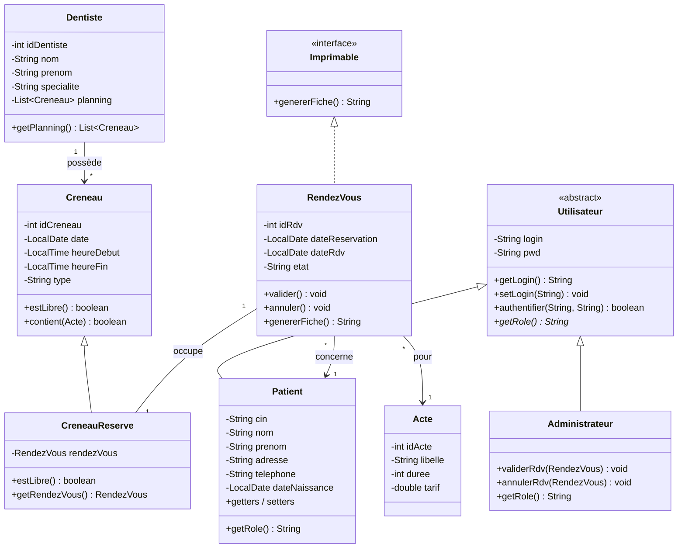
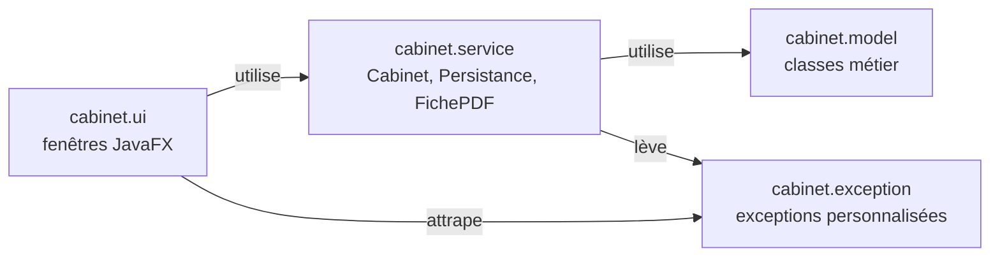
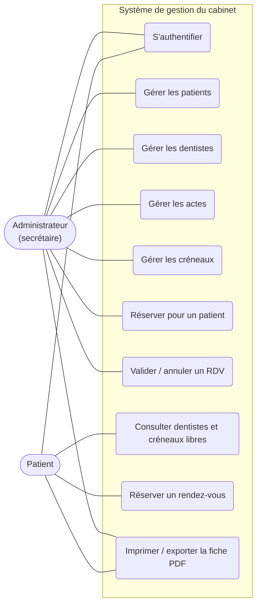
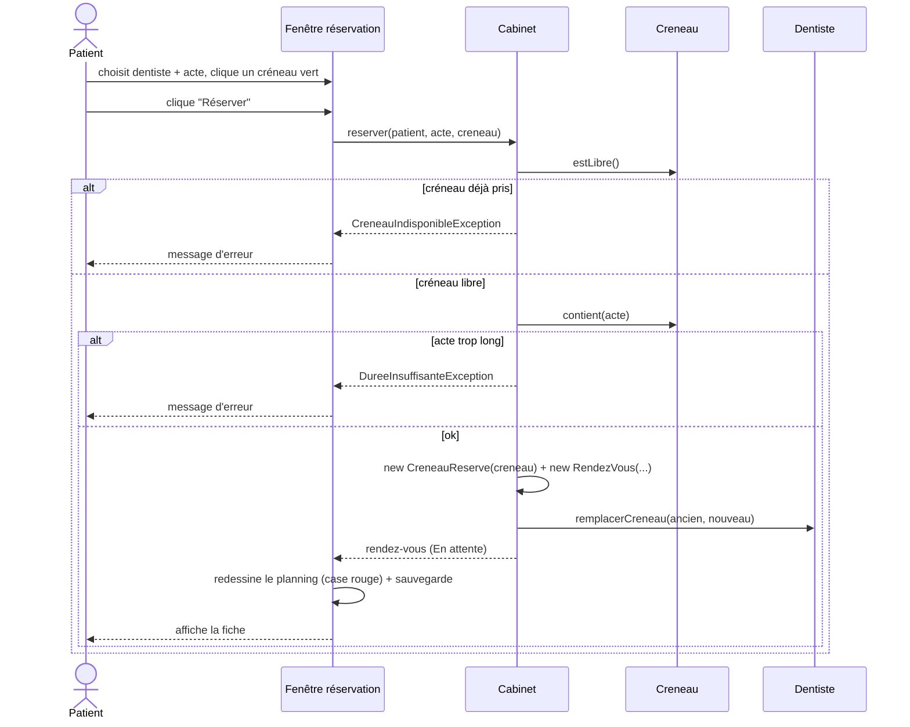
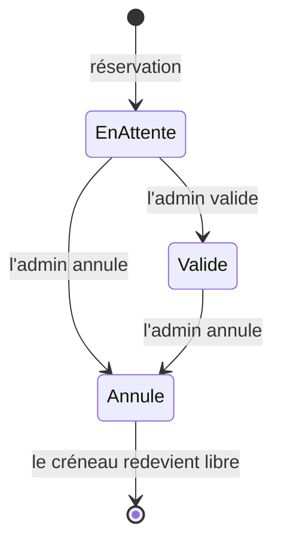

# Diagrammes UML - Gestion d'un cabinet dentaire

Version corrigée (21/10/2026) : elle suit exactement le diagramme de la prof (sujet, page 2) et le code du projet `CabinetDentaire`.
Pour les transformer en images : coller chaque bloc dans https://mermaid.live puis exporter en PNG/SVG.

## 1. Diagramme de classes

## 2. Diagramme de packages

## 3. Cas d'utilisation

Mermaid n'a pas de vrai diagramme de cas d'utilisation : ce schéma en donne l'équivalent.

## 4. Séquence : réservation par un patient

## 5. États d'un rendez-vous

